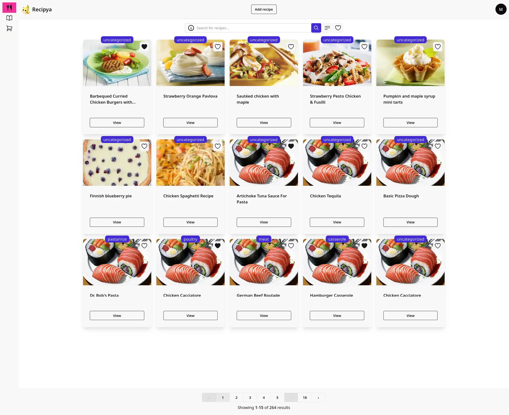

<h1 align="center">
   
      Recipya Rust
   
</h1>

<h4 align="center">A clean, simple and powerful recipe manager your whole family will enjoy.</h4>

    
    
    

    <a href="https://recipes.musicavis.ca/guide/docs/" target="_blank" rel="noopener noreferrer">Website</a> •
    <a href="https://recipya.ca" target="_blank" rel="noopener noreferrer">Demo</a> •
    <a href="https://app.element.io/#/room/%23comfyui_space%3Amatrix.org" target="_blank" rel="noopener noreferrer">Matrix</a>

Table of Contents
=================

* [Features](#features)
* [Installation](#installation)
* [Migrating from Recipya (Go version)](#migrating-from-recipya-go-version)
* [Contributing](#contributing)
* [AI Disclaimer](#ai-disclaimer)
* [Sponsors](#sponsors)
* [Roadmap](#roadmap)
* [Inspiration](#inspiration)

## Features

- Manage your favorite recipes
- Import recipes from around the web
- Digitize paper recipes
- Organize your recipes into cookbooks
- Works seamlessly with [Nextcloud Cookbook](https://apps.nextcloud.com/apps/cookbook)
- Automatic conversion to your preferred measurement system (imperial/metric)
- Calculate nutritional information automatically
- Print any recipe in your collection
- Prevent your device from going to sleep while viewing a recipe
- Follows your system's theme (light/dark)
- Cross-compiled for Windows, Linux, and macOS

## Installation

The software can be installed using either Docker or Podman. Please consult the [installation guide](./docs/installation.md) for details.

## Migrating from Recipya (Go version)

If you want to migrate your Recipya Go data over to Recipya Rust, please follow the [migration guide](./docs/migration-from-recipya-go-version.md).

### Quick summary

1. **Update Recipya Go**: Update your Docker image tag to `nightly`, then pull and restart the container.
2. **Access the app**: Open your Recipya Go web interface
3. **Export data**: Go to `Settings → Data` and download your data export as JSON.
4. **Import data**: From the Recipya Rust interface, click `Add recipe → Import → Software`, select the `Recipya` application, and upload your archive.

## Contributing

Please consult the [contribution guide](./CONTRIBUTING.md) for details on how you can contribute to the project.

## AI Disclaimer

What is there to be proud of if your project is generated by AI? You didn't write your art. The machine did.

Recipya is a project where AI is used sparingly. And when it is used, it serves as a  rubber duck, a research tool, a debugging assistant and sometimes a guide on idiomatic Rust. I never ran an agent like Claude Code and Codex. All features were designed and planned by hand or thought of in the shower. The database was entirely designed on paper to see the relationships between tables. Some features, such as the [shopping list] one, [contact], and [SMS] are also entirely planned on paper before coding.

Functions that were entirely generated by AI have an `// AI usage:` comment. This usually happens when I don't know the domain of what I'm trying to solve enough. The Bananacat (the mascot) and the default recipe image were generated using ComfyUI. It would one day be great if a non-AI mascot could be created using [Inkscape]. 

I want Recipya to stay human and avoid becoming unmaintainable slop.

[shopping list]: https://github.com/reaper47/recipya-rs/issues/268
[contact]: https://github.com/reaper47/recipya-rs/issues/316
[SMS]: https://github.com/reaper47/recipya-rs/issues/310
[Inkscape]: https://inkscape.org/

## Sponsors

I am grateful for any support that motivates me to continue developing this project and to host it reliably.

You can sponsor me on
[GitHub Sponsors](https://github.com/sponsors/reaper47) or
[Buy Me a Coffee](https://www.buymeacoffee.com/macpoule).

Your support is greatly appreciated! A third of donations will be sent to the Armed Forces of Ukraine.

This project is supported by these kind people:

## Roadmap

Please consult the [roadmap document](./ROADMAP.md) for details.

## Inspiration

This project was mainly coded to blasting the following albums:

- [1914 - Viribus Unitis](https://www.youtube.com/watch?v=IET5AyShGYc)
- [4am](https://www.youtube.com/watch?v=tBcPji_jRDc)
- [Abysmal Dawn - Phylogenesis](https://www.youtube.com/watch?v=xJMybqRMedk&pp=ygUMYWJ5c21hbCBkYXdu)
- [Archspire - Bleed the Future](https://www.youtube.com/watch?v=o8H9ahswldM)
- [Archspire - Too Fast to Die](https://www.youtube.com/watch?v=bKlxhjKfnMQ)
- [Astralborne - Eternity's End](https://www.youtube.com/watch?v=MilBEj5W9io)
- [Atavistia - Cosmic Warfare](https://www.youtube.com/watch?v=VjJ_zb4RF2E)
- [Beast In Black - Dark Connection](https://www.youtube.com/watch?v=7NyON-NzBr4)
- [Cattle Decapitation - Terrasite](https://www.youtube.com/watch?v=x6rEDMqM36I)
- [Desoration - NON](https://www.youtube.com/watch?v=QGagHu8EvyY)
- [Ensiferum - From Afar](https://www.youtube.com/watch?v=6r8OPu3SRSM)
- [Fires in the Distance - Echoes From Deep November](https://www.youtube.com/watch?v=dnOE5nm6rfo)
- [Kalmah - Swamplord](https://www.youtube.com/watch?v=FhMsOB88dfo&list=PLkROH3Eqs0T9b5E2WDDOS0JgYLf24_dNs)
- [Lofi Girl - lofi hip hop radio](https://www.youtube.com/watch?v=jfKfPfyJRdk)
- [Lofi Girl - synthwave radio](https://www.youtube.com/watch?v=4xDzrJKXOOY)
- [Mozart - Requiem Dm](https://www.youtube.com/watch?v=pBGVfwOLU1w0)
- [Necrophobic - In the Twilight Grey](https://www.youtube.com/watch?v=eDFD6YnMid8)
- [Pain - You Only Live Twice](https://www.youtube.com/watch?v=obgCEoLzLs4)
- [Sonata Arctica - Talviyö](https://www.youtube.com/watch?v=x6rEDMqM36I)
- [Wintersun - Wintersun](https://www.youtube.com/watch?v=W0M3HAMus7g&pp=ygUPd2ludGVyc3VuIGFsYnVt)
- [Wintersun - Time I & II](https://www.youtube.com/watch?v=dl3pkdAzHrw)
