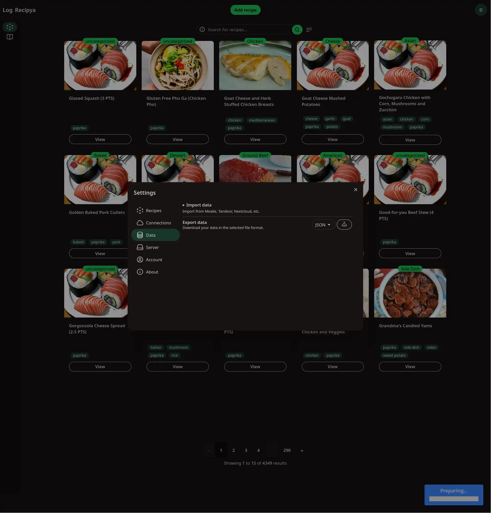
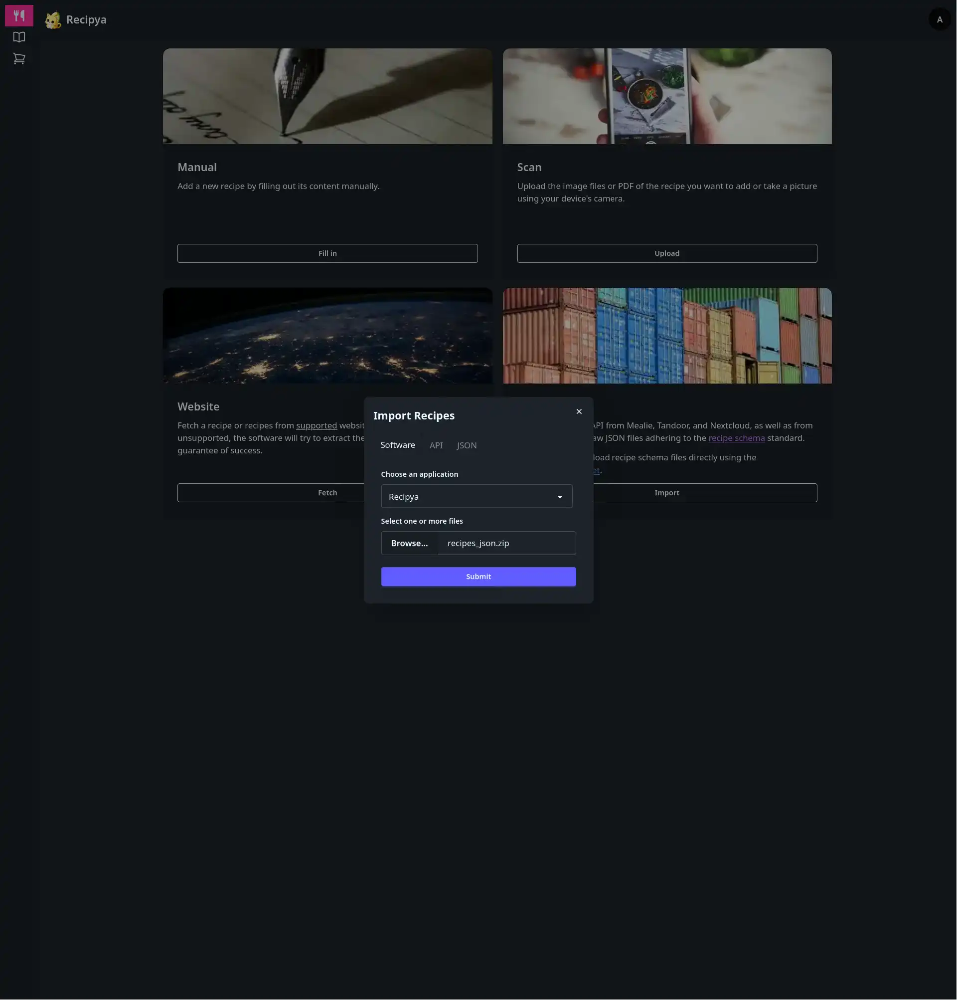

# Migration from Recipya Go

Migrating from [Recipya Go](https://github.com/reaper47/recipya) is a straight-forward process involving a few simple steps.

## 1. Update Recipya Go

The latest Recipya updates include fixes for data export compatibility with Recipya Rust. You must update your Docker image to the latest `nightly` tag. If you are using a tag other than nightly, update the image's tag to `nightly` in your Docker Compose file.

```yaml
services:
  web:
    image: reaper99/recipya:nightly
    container_name: recipya
    ...
    volumes:
          "recipya-data:/home/recipya/.config/Recipya"
    ...
```

Then, update your image and restart the container:
```bash
docker compose pull
docker compose up -d
```

## 2. Access the app

Now that you are running the latest version of Recipya Go, open the web application.

## 3. Export data

Access the settings and navigate to the `Data` tab. Click the download icon next to `Export your data (JSON)`.



## 4. Import the exported data

Open your your Recipya Rust web application, click the `Add recipe` button at the top, and click the `Import` button. Under the `Software` tab, select `Recipya` as the source software and choose the exported `recipes_json.zip` file. Submit the form, and the recipes will be imported.


